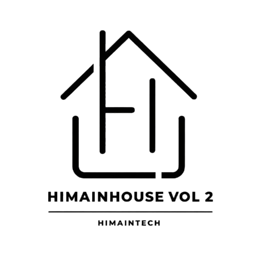

# 🚀 Modul Workshop: Membangun Website Portofolio & Hosting Gratis 100% dengan Git & GitHub
### HIMAINHOUSE VOL. 2

<p align="center">
  
  
  
</p>

> **Penyelenggara**: **HIMA INTECH** (Himpunan Mahasiswa Informatika) &bull; **Program Studi Informatika Universitas Teknologi Digital**  
> **Rujukan Materi**: Seri Tutorial Git & GitHub — **Web Programming UNPAS (Sandhika Galih)**  
> **Target Luaran**: Peserta memiliki website portofolio pribadi aktif yang tayang online secara gratis di internet menggunakan **GitHub Pages**.

---

## 📋 Daftar Isi Modul
1. [Bab 1: Konsep Version Control System — Mengapa Butuh Git?](#bab-1-konsep-version-control-system--mengapa-butuh-git)
2. [Bab 2: Perbedaan Mendasar Git vs GitHub](#bab-2-perbedaan-mendasar-git-vs-github)
3. [Bab 3: Instalasi & Perintah Dasar Terminal](#bab-3-instalasi--perintah-dasar-terminal)
4. [Bab 4: Konfigurasi Identitas Git Awal](#bab-4-konfigurasi-identitas-git-awal)
5. [Bab 5: Tiga Area Kerja Git & Siklus Rekam Perubahan](#bab-5-tiga-area-kerja-git--siklus-rekam-perubahan)
6. [Bab 6: Percabangan (Branching) & Penggabungan (Merging)](#bab-6-percabangan-branching--penggabungan-merging)
7. [Bab 7: Menghubungkan Repositori Lokal ke GitHub (Remote)](#bab-7-menghubungkan-repositori-lokal-ke-github-remote)
8. [Bab 8: Hosting Gratis 100% Menggunakan GitHub Pages](#bab-8-hosting-gratis-100-menggunakan-github-pages)
9. [Bab 9: Alur Kerja Harian (Daily Workflow Update Website)](#bab-9-alur-kerja-harian-daily-workflow-update-website)
10. [Bab 10: Panduan Khusus Pemateri & Troubleshooting di Kelas](#bab-10-panduan-khusus-pemateri--troubleshooting-di-kelas)

---

## Bab 1: Konsep Version Control System — Mengapa Butuh Git?
*(Rangkuman WPU Video #1)*

### 1. Tragedi Penamaan File Tradisional
Sebelum mengenal Git, mahasiswa atau pengembang sering menyimpan revisi file dengan cara manual seperti ini:
* `portofolio.html`
* `portofolio_revisi.html`
* `portofolio_revisi_final.html`
* `portofolio_revisi_final_bismillah.html`
* `portofolio_revisi_final_FIX_BANGET.html`

Masalah dari cara ini:
1. Memakan kapasitas penyimpanan.
2. Tidak tahu bagian mana yang diubah kemarin atau minggu lalu.
3. Sangat sulit kembali ke versi kode sebelumnya jika terjadi error (*bug*).

### 2. Solusi: Version Control System (VCS)
VCS adalah sistem yang merekam setiap perubahan pada file dari waktu ke waktu sehingga kamu bisa melihat riwayatnya, membandingkan perubahannya, atau melompat kembali ke kondisi kode di masa lampau (*mesin waktu koding*).

---

## Bab 2: Perbedaan Mendasar Git vs GitHub
*(Rangkuman WPU Video #1)*

Banyak pemula mengira Git dan GitHub adalah hal yang sama. Padahal keduanya berbeda:

| Aspek | Git | GitHub |
| :--- | :--- | :--- |
| **Definisi** | Software/alat *Version Control System* (VCS) terdistribusi. | Layanan hosting berbasis web (*cloud*) untuk menyimpan repositori Git. |
| **Lokasi Berjalan** | Berjalan secara **lokal** di komputer/laptopmu (tanpa internet). | Berjalan secara **online** di internet (butuh koneksi). |
| **Antarmuka** | Berbasis teks (*Command Line Interface* / Terminal). | Berbasis grafis web (*Graphical User Interface* / Website). |
| **Fungsi Utama** | Melacak perubahan file dan membuat riwayat commit. | Tempat mencadangkan kode, kolaborasi tim, dan **hosting gratis**. |

> **Analogi Sederhana**: Git itu seperti kameranya (mengambil rekaman snapshot kode), sedangkan GitHub itu seperti Google Photos atau Instagram (tempat mengunggah dan membagikan foto secara online).

---

## Bab 3: Instalasi & Perintah Dasar Terminal
*(Rangkuman WPU Video #2 & #3)*

### 1. Unduh Git
* Buka situs resmi: [git-scm.com](https://git-scm.com/)
* Unduh versi sesuai OS (untuk Windows, instalasi sudah menyertakan **Git Bash**).
* Saat instalasi, biarkan pilihan default (*Next* sampai selesai).
* Untuk memeriksa apakah Git sudah terpasang, buka terminal dan ketik:
  ```bash
  git --version
  # Output contoh: git version 2.40.0.windows.1
  ```

### 2. Perintah Dasar Terminal (CLI) yang Wajib Dikuasai
Sebelum memakai Git, peserta wajib memahami perintah navigasi terminal:
* `pwd` (*Print Working Directory*): Mengetahui posisi folder kamu saat ini.
* `ls` (*List*): Melihat daftar file dan folder di direktori aktif.
* `cd <nama_folder>` (*Change Directory*): Masuk ke dalam folder.
* `cd ..`: Naik/mundur satu tingkat ke folder di atasnya.
* `mkdir <nama_folder>` (*Make Directory*): Membuat folder baru.
* `clear`: Membersihkan tampilan layar terminal.

---

## Bab 4: Konfigurasi Identitas Git Awal
*(Rangkuman WPU Video #4)*

Sebelum membuat catatan revisi, Git harus tahu **siapa yang melakukan perubahan**. Langkah ini cukup dilakukan **satu kali saja** di komputermu:

```bash
# 1. Atur Nama Lengkapmu
git config --global user.name "Daifa"

# 2. Atur Alamat Email (Gunakan email yang sama dengan akun GitHub)
git config --global user.email "emailkamu@gmail.com"

# 3. Periksa Konfigurasi
git config --list
```

---

## Bab 5: Tiga Area Kerja Git & Siklus Rekam Perubahan
*(Rangkuman WPU Video #5)*

Ini adalah konsep paling penting di Git:

```text
+-----------------------+      git add       +------------------+     git commit     +-------------------+
|   Working Directory   | -----------------> |   Staging Area   | -----------------> |    Repository     |
| (File yang diedit)    |                    |  (Daftar siap catat) |                 | (Snapshot abadi)  |
+-----------------------+                    +------------------+                    +-------------------+
```

### Praktik Langkah demi Langkah pada Project Portofolio:

#### 1. Inisialisasi Git Lokal
Buka folder `DAIFA_Portfolio_Layout_Refined` melalui terminal / Git Bash, lalu ketik:
```bash
git init
```
*Efek*: Git membuat folder tersembunyi bernama `.git`. Sekarang folder proyekmu resmi diawasi oleh Git.

#### 2. Cek Status File
```bash
git status
```
*File yang berwarna merah berarti berada di **Working Directory** (belum dimasukkan ke daftar siap catat).*

#### 3. Pindahkan File ke Staging Area
```bash
# Titik (.) artinya memasukkan SEMUA file dan folder ke Staging Area
git add .
```
Jika dicek lagi dengan `git status`, file akan berubah menjadi warna hijau (berada di **Staging Area**).

#### 4. Rekam Snapshot (Commit)
```bash
git commit -m "Inisialisasi awal portofolio clean code Daifa"
```
*Commit* adalah rekaman snapshot permanen. Selalu gunakan pesan commit (`-m`) yang menjelaskan apa yang baru saja kamu ubah.

#### 5. Melihat Riwayat Waktu
```bash
git log
# Atau versi ringkas satu baris:
git log --oneline
```

---

## Bab 6: Percabangan (Branching) & Penggabungan (Merging)
*(Rangkuman WPU Video #6)*

*Branch* memungkinkan kamu bereksperimen dengan fitur baru tanpa merusak kode utama.

```bash
# 1. Melihat daftar branch aktif
git branch

# 2. Membuat dan berpindah ke branch baru untuk eksperimen
git checkout -b eksperimen-warna
# (atau perintah modern: git switch -c eksperimen-warna)

# 3. Lakukan pengeditan kode (misal ubah CSS), lalu commit:
git add .
git commit -m "Eksperimen warna aksen baru"

# 4. Kembali ke cabang utama (main)
git checkout main

# 5. Gabungkan hasil eksperimen ke main jika hasilnya memuaskan
git merge eksperimen-warna
```

---

## Bab 7: Menghubungkan Repositori Lokal ke GitHub (Remote)
*(Rangkuman WPU Video #7)*

Sekarang kita akan mengunggah kode portofolio lokal ke cloud GitHub:

### 1. Buat Repositori di Website GitHub
1. Buka browser, login ke [github.com](https://github.com/).
2. Klik tombol **New** (ikon tanda tambah `+` di kanan atas) untuk membuat repositori baru.
3. Masukkan nama repositori, contoh: `portofolio-daifa` (atau `my-portfolio`).
4. Atur visibilitas ke **Public**.
5. **PENTING**: Kosongkan opsi *Initialize with README*, *.gitignore*, dan *license* (karena proyek lokal kita sudah memiliki file tersebut).
6. Klik **Create repository**.

### 2. Hubungkan & Push ke GitHub
Di halaman repositori GitHub yang baru dibuat, salin URL HTTPS-nya. Kemudian jalankan 3 perintah ini di terminal proyekmu:

```bash
# 1. Pastikan nama cabang utama adalah 'main'
git branch -M main

# 2. Hubungkan repositori lokal ke GitHub (contoh repo resmi proyek ini):
git remote add origin https://github.com/daifa-maulana/Himainhouse.git

# 3. Unggah seluruh kode ke GitHub
git push -u origin main
```
*Catatan: Jika baru pertama kali, browser akan memunculkan jendela login GitHub (GitHub Authentication).*

---

## 🎨 Bab Khusus: Standar Pesan Commit Profesional Menggunakan Gitmoji
*Gitmoji* adalah konvensi internasional penggunaan emoji pada pesan commit Git. Tujuannya agar riwayat perubahan kode menjadi lebih ekspresif, rapi, dan mudah dipindai secara visual oleh tim atau rekruter.

### Daftar Gitmoji Paling Populer di Industri:
| Emoji | Kode Gitmoji | Kapan Digunakan? | Contoh Pesan Commit |
| :---: | :--- | :--- | :--- |
| 🎉 | `:tada:` | Inisialisasi awal proyek (*first commit*) | `git commit -m ":tada: Initial commit portofolio"` |
| ✨ | `:sparkles:` | Menambahkan fitur atau konten baru | `git commit -m ":sparkles: Add dark mode toggle"` |
| 💄 | `:lipstick:` | Memperbarui tampilan UI / file CSS | `git commit -m ":lipstick: Refine glassmorphism navbar"` |
| 📝 | `:memo:` | Menulis atau mengedit dokumentasi / README | `git commit -m ":memo: Add Git workshop module"` |
| 🐛 | `:bug:` | Memperbaiki bug atau kesalahan tampilan | `git commit -m ":bug: Fix avatar image overflow on mobile"` |
| ⚡ | `:zap:` | Meningkatkan performa atau kecepatan muat | `git commit -m ":zap: Optimize image assets compression"` |
| ♿ | `:wheelchair:` | Meningkatkan aksesibilitas web (a11y) | `git commit -m ":wheelchair: Improve keyboard skip link"` |
| 🚀 | `:rocket:` | Merilis atau mendeploy website ke hosting | `git commit -m ":rocket: Deploy portfolio to GitHub Pages"` |

---

## Bab 8: Hosting Gratis 100% Menggunakan GitHub Pages

Setelah kode berada di GitHub, kita bisa menyalakan fitur **GitHub Pages** agar website portofoliomu online dan bisa diakses oleh siapa saja di seluruh dunia secara **gratis 100% selamanya tanpa biaya server**.

### Langkah-Langkah Mengaktifkan GitHub Pages:
1. Buka halaman repositori portofoliomu di **GitHub**:  
   👉 [https://github.com/daifa-maulana/Himainhouse](https://github.com/daifa-maulana/Himainhouse)
2. Klik menu tab **Settings** (ikon gerigi di atas).
3. Pada sidebar sebelah kiri, cari dan klik menu **Pages** (di bawah kategori *Code and automation*).
4. Di bagian **Build and deployment**:
   * **Source**: Pilih `Deploy from a branch`.
   * **Branch**: Pilih cabang `main` dan folder `/ (root)`.
5. Klik tombol **Save**.
6. Tunggu sekitar 1 hingga 2 menit. Refresh halaman Settings > Pages tersebut.
7. Di bagian atas akan muncul kotak notifikasi hijau:
   > **Your site is live at: `https://daifa-maulana.github.io/Himainhouse/`**
8. Klik tautan tersebut, dan selamat! Website portofoliomu sudah resmi online di internet! 🌐🎉

> **Tips Keren Domain Utama**:  
> Jika kamu memberi nama repositori persis dengan format: `username-kamu.github.io`, maka website portofoliomu akan tayang langsung di domain utama:  
> 👉 **`https://username-kamu.github.io/`** (tanpa embel-embel nama folder di belakangnya).

---

## Bab 9: Alur Kerja Harian (Daily Workflow Update Website)

Setelah website online, bagaimana cara memperbarui kontennya (misalnya ganti foto atau tambah proyek baru)? Sangat mudah, cukup ikuti alur 3 langkah ini di terminal:

```bash
# Langkah 1: Masukkan perubahan file ke Staging
git add .

# Langkah 2: Buat catatan snapshot commit
git commit -m "Update deskripsi proyek dan foto profil terbaru"

# Langkah 3: Kirim ke GitHub
git push
```

Dalam waktu sekitar 1 menit, GitHub Pages akan otomatis memperbarui tampilan website online-mu secara otomatis tanpa perlu setup ulang!

---

## Bab 10: Panduan Khusus Pemateri & Troubleshooting di Kelas

### Rekomendasi Alokasi Waktu Workshop (Total 2 Jam):
* **00:00 - 00:20 (20 Menit)**: Teori WPU: Masalah revisi manual, apa itu Git & GitHub, analogi 3 area kerja.
* **00:20 - 00:40 (20 Menit)**: Instalasi Git, setting `user.name` & `user.email`, bedah terminal dasar.
* **00:40 - 01:10 (30 Menit)**: Bedah template portofolio clean code ini, eksplorasi `index.html` dan `style.css`.
* **01:10 - 01:35 (25 Menit)**: Praktik `git init`, `git add`, `git commit`, dan membuat repo di GitHub.
* **01:35 - 01:50 (15 Menit)**: Melakukan `git push` dan menyalakan **GitHub Pages**.
* **01:50 - 02:00 (10 Menit)**: Sesi tanya jawab & saling membagikan link portofolio yang sudah online di grup kelas.

### Troubleshooting Populer di Kelas & Solusinya:

| Gejala Masalah | Penyebab | Solusi Cepat Pemateri |
| :--- | :--- | :--- |
| **Error: `remote origin already exists`** | Peserta salah mengetik URL remote atau mengulang perintah add. | Jalankan `git remote remove origin`, lalu ulangi `git remote add origin <URL-yang-benar>`. |
| **Gagal Push (Authentication Failed)** | GitHub tidak lagi mendukung password biasa, melainkan Personal Access Token / Browser Auth. | Pastikan peserta login melalui pop-up browser (*Sign in with browser*) yang muncul otomatis saat push. |
| **Gambar tidak muncul di GitHub Pages** | Jalur gambar (*case-sensitive*) atau path absolut salah. | Pastikan di `index.html` menggunakan path relatif: `src="assets/images/daifa.png"` (bukan diawali garis miring mutlak `/assets/...`). |
| **GitHub Pages 404 Not Found** | File utama bukan bernama `index.html` atau proses build masih berjalan. | Pastikan file root bernama huruf kecil semua `index.html`. Tunggu 1–2 menit hingga ikon bundar di tab Actions berubah hijau centang. |

---

## 📚 Sumber Belajar Lanjutan
* **Playlist Resmi WPU**: [Git & GitHub - Web Programming UNPAS](https://www.youtube.com/playlist?list=PLFIM0718LjIVknj6sgsSceMqlq242-jNf) oleh Sandhika Galih.
* **Dokumentasi Resmi Git**: [git-scm.com/doc](https://git-scm.com/doc)
* **Dokumentasi Resmi GitHub Pages**: [docs.github.com/en/pages](https://docs.github.com/en/pages)

