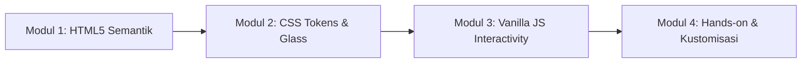

# 📘 Panduan Pembelajaran Web Development: HTML, CSS, & Vanilla JS

Dokumen ini disusun sebagai **buku panduan instruktur (*Instructor Handbook*)** dan **lembar kerja siswa (*Student Worksheet*)** untuk proyek website portofolio modern ini.

---

## 🎯 Capaian Pembelajaran (Learning Outcomes)

Setelah menyelesaikan materi ini, siswa/peserta diharapkan mampu:
1. Menulis struktur dokumen web menggunakan **HTML5 Semantik** dan menerapkan prinsip aksesibilitas (*a11y*).
2. Membangun sistem desain modular di CSS menggunakan **Design Tokens (`:root`)**, **Flexbox**, dan **CSS Grid**.
3. Membuat komponen antarmuka modern seperti **Liquid Frosted Glass Navbar** dan tata letak responsif (*Mobile-First*).
4. Menghubungkan interaksi antarmuka menggunakan **Vanilla JavaScript murni** (DOM Manipulation, Event Listeners, Clipboard API, & IntersectionObserver).
5. Memahami standar penulisan kode profesional (*Clean Code & Separation of Concerns*).

---

## 🧭 Silabus & Alur Pengajaran (Total: 90–120 Menit)



---

### Sesi 1: Kerangka & Semantik HTML5 (25 Menit)

#### 1. Pembahasan Konsep
* **Mengapa HTML Semantik Penting?**
  * Hindari kebiasaan buruk membuat semua elemen menjadi `<div>`.
  * Tunjukkan perbedaan `<header>`, `<nav>`, `<main>`, `<section>`, `<article>`, `<figure>`, dan `<footer>`.
* **Aksesibilitas (a11y) & Skip Link**:
  * Tunjukkan fungsi `<a class="skip-link" href="#main-content">`.
  * *Demo Pemateri*: Buka browser, tekan tombol `Tab` pada keyboard, perlihatkan tombol *skip-link* yang muncul di pojok kiri atas.

#### 2. Pertanyaan Pemantik untuk Siswa:
> *"Apa akibatnya bagi mesin pencari Google dan pengguna tunanetra jika seluruh website hanya dibuat menggunakan tag `<div>` tanpa tag semantik?"*

---

### Sesi 2: Styling Modern, Flexbox, Grid, & Glassmorphism (35 Menit)

#### 1. Pembahasan Konsep
* **Design Tokens (`:root`)**:
  * Jelaskan keuntungan variabel CSS terpusat dibanding menulis kode warna berulang-ulang.
* **Kapan Menggunakan Flexbox vs CSS Grid?**:
  * **Flexbox (1 Dimensi)**: Dipakai pada navbar (`.dock-nav`) untuk meratakan logo di kiri dan menu di kanan.
  * **CSS Grid (2 Dimensi)**: Dipakai pada kartu proyek (`.project-grid`) untuk membuat pembagian 3-kolom yang presisi.
* **Anatomi Efek Liquid Frosted Glass**:
  ```css
  background: rgba(255, 255, 255, 0.45);
  backdrop-filter: blur(28px) saturate(190%) contrast(105%);
  border: 1px solid rgba(255, 255, 255, 0.65);
  box-shadow: inset 0 1px 1.5px 0 rgba(255, 255, 255, 0.95);
  ```
  * Tunjukkan bagaimana kombinasi `backdrop-filter` dan `inset shadow` menghasilkan ilusi kaca optik yang membiaskan elemen di belakangnya.
* **Fluid Typography (`clamp`)**:
  * Jelaskan rumus `font-size: clamp(38px, 6.2vw, 76px);` yang otomatis beradaptasi tanpa perlu menulis banyak `@media query`.

#### 2. Latihan Praktik Siswa:
* Minta siswa membuka `assets/css/style.css` baris 24.
* Ganti nilai `--accent: #485c44;` dengan warna pilihan masing-masing (misal `#2563eb` atau `#d97706`).
* *Amati*: Seluruh tombol, badge, dan sorotan website langsung berubah secara serentak.

---

### Sesi 3: Interaksi JavaScript Murni Tanpa Framework (25 Menit)

#### 1. Pembahasan Konsep
* **Zero Dependencies**: Jelaskan keunggulan Vanilla JS (kecepatan eksekusi kilat, nol risiko keamanan dependensi luar).
* **3 Fitur Utama di `assets/js/script.js`**:
  1. **Hamburger Menu Drawer**: Menggunakan `classList.toggle('is-open')` dan menangani tombol keyboard `Escape`.
  2. **Clipboard API**: Menyalin alamat email secara instan menggunakan `navigator.clipboard.writeText()` dengan umpan balik visual (*toast notification*).
  3. **Intersection Observer**: Memicu animasi kemunculan elemen (`.reveal`) dan menyorot menu navigasi aktif (*scrollspy*) secara hemat daya komputasi.

#### 2. Pertanyaan Pemantik untuk Siswa:
> *"Mengapa menggunakan `IntersectionObserver` jauh lebih cepat dan hemat baterai daripada mendengarkan event `window.addEventListener('scroll', ...)`?"*

---

### Sesi 4: Hands-on Workshop & Kustomisasi Portofolio (25 Menit)

Setiap siswa diarahkan untuk mengubah proyek ini menjadi portofolio pribadi mereka sendiri:
1. **Mengubah Konten Teks**:
   * Nama, peran (*role*), dan deskripsi diri di bagian Hero.
   * Riwayat pendidikan dan minat di bagian About & Journey.
   * Tiga proyek kebanggaan mereka sendiri di bagian Selected Work.
2. **Mengganti Foto Avatar**:
   * Menaruh foto pribadi ke `assets/images/` dan menyambungkan jalurnya di tag ``.
3. **Mengganti Email Kontak**:
   * Menyesuaikan alamat email aktif pada tag `mailto:` dan atribut `data-email`.

---

## 🧪 Tantangan Mandiri untuk Siswa (Coding Challenges)

Untuk menguji pemahaman peserta, berikan tantangan bertingkat berikut:

### Level 1: Mudah (Tantangan CSS)
* **Tantangan**: Ubah sudut kartu proyek dari melengkung sedang (`24px`) menjadi melengkung penuh kapsul atau sudut tegas (`8px`).
* **Petunjuk**: Cari variabel `--radius-card` pada file `style.css`.

### Level 2: Menengah (Tantangan HTML & CSS)
* **Tantangan**: Tambahkan 1 kartu proyek baru ke dalam bagian Selected Work sehingga total proyek menjadi 4. Perhatikan bagaimana grid 3-kolom merespons kartu ke-4 tersebut.
* **Petunjuk**: Salin satu blok `<article class="project-card">` di `index.html`.

### Level 3: Mahir (Tantangan JavaScript)
* **Tantangan**: Tambahkan tombol "Dark Mode / Light Mode" sederhana pada navbar yang membalikkan warna latar belakang dan warna teks dokumen.
* **Petunjuk**: Gunakan `document.body.classList.toggle('dark-theme')` dan buat variabel tema alternatif di CSS.

---

## ❓ FAQ & Troubleshooting Saat Mengajar

| Masalah / Pertanyaan | Penyebab Umum | Solusi Cepat |
| :--- | :--- | :--- |
| **Gambar avatar tidak muncul** | Nama file atau huruf besar/kecil (*case-sensitive*) tidak cocok. | Pastikan nama file di folder `assets/images/` persis sama dengan atribut `src` di `index.html`. |
| **Efek blur kaca tidak terlihat** | Browser versi sangat lama atau hardware acceleration mati. | Pastikan browser Chrome/Edge/Firefox telah diperbarui ke versi modern. |
| **Animasi scroll tidak bergerak** | Fitur JavaScript browser dimatikan atau pengguna menyalakan mode *Reduce Motion*. | Periksa apakah sistem operasi mengaktifkan *Reduced Motion*; CSS kita secara cerdas mematikan animasi jika mode tersebut aktif demi kenyamanan pengguna. |
| **Fitur salin email gagal** | Halaman dibuka pada protokol non-HTTPS/non-localhost di browser tertentu. | Kode JavaScript kita sudah dilengkapi *fallback* otomatis menggunakan elemen `textarea` sementara jika Clipboard API dibatasi. |

---

## 📚 Ringkasan Filosofi Clean Code untuk Siswa
> *"Kode yang baik bukan hanya kode yang bisa dimengerti oleh komputer, melainkan kode yang bisa dibaca dan dirawat dengan mudah oleh manusia lain."*

