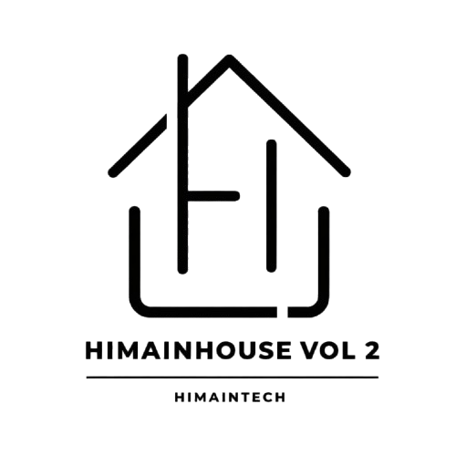

---
# ============================================================
# SLIDES WORKSHOP — HIMAINHOUSE VOL. 2
# Format      : Marp (Markdown Presentation Ecosystem)
# Rujukan Asli: Google Presentation HIMAINHOUSE VOL 2
# Tema        : Putih Dominan Minimalis (#ffffff), Clean Typography
# Penyelenggara: Prodi Informatika, HIMA INTECH, HIMAINHOUSE VOL 2
# ============================================================
marp: true
theme: default
paginate: true
backgroundColor: #ffffff
color: #141713
style: |
  @import url('https://fonts.googleapis.com/css2?family=Plus+Jakarta+Sans:wght@400;500;600;700;800&family=JetBrains+Mono:wght@400;500;600&display=swap');

  section {
    font-family: 'Plus Jakarta Sans', -apple-system, BlinkMacSystemFont, sans-serif;
    padding: 36px 48px;
    font-size: 19px;
    line-height: 1.5;
    background: #ffffff;
    color: #141713;
  }

  /* ── Header Atas Setiap Slide: Tag Kiri & 3 Logo Kanan ── */
  .slide-header {
    display: flex;
    justify-content: space-between;
    align-items: center;
    margin-bottom: 14px;
    min-height: 32px;
  }
  .slide-tag {
    font-size: 11px;
    font-weight: 700;
    letter-spacing: 0.12em;
    text-transform: uppercase;
    color: #5e645a;
  }
  .slide-logos {
    display: flex;
    align-items: center;
    gap: 10px;
  }
  .slide-logos img {
    height: 26px;
    width: auto;
    object-fit: contain;
  }
  .slide-logos .round {
    border-radius: 50%;
  }

  /* ── Judul ── */
  h1 {
    font-size: 40px;
    font-weight: 800;
    letter-spacing: -0.03em;
    line-height: 1.15;
    color: #141713;
    margin: 8px 0 10px;
  }
  h2 {
    font-size: 28px;
    font-weight: 700;
    letter-spacing: -0.02em;
    color: #141713;
    margin: 0 0 18px;
    line-height: 1.25;
  }
  h3 {
    font-size: 18px;
    font-weight: 700;
    color: #141713;
    margin: 0 0 6px;
  }

  /* ── Teks & List ── */
  p { font-size: 18px; color: #3d4239; margin: 0 0 10px; line-height: 1.55; }
  li { font-size: 18px; color: #3d4239; margin-bottom: 6px; line-height: 1.5; }
  ul, ol { margin: 6px 0 14px; padding-left: 24px; }

  /* ── Kotak Kode Gelap Modern ── */
  pre {
    background: #191c18;
    border-radius: 12px;
    padding: 16px 20px;
    margin: 10px 0;
    border: 1px solid rgba(0,0,0,0.06);
  }
  pre code {
    font-family: 'JetBrains Mono', monospace;
    background: transparent;
    color: #bbf7d0;
    padding: 0;
    font-size: 0.78em;
    line-height: 1.55;
  }
  code {
    font-family: 'JetBrains Mono', monospace;
    background: #f0f3ec;
    color: #273824;
    padding: 2px 7px;
    border-radius: 5px;
    font-size: 0.86em;
    font-weight: 600;
  }

  /* ── Grid & Card Containers ── */
  .grid-2 {
    display: grid;
    grid-template-columns: 1.1fr 1fr;
    gap: 28px;
    align-items: center;
  }
  .grid-3 {
    display: grid;
    grid-template-columns: repeat(3, 1fr);
    gap: 18px;
  }
  .grid-4 {
    display: grid;
    grid-template-columns: repeat(4, 1fr);
    gap: 14px;
  }
  .card {
    background: #f7f8f5;
    border: 1px solid #e8ebe3;
    border-radius: 12px;
    padding: 18px 16px;
  }
  .card-dark-green {
    background: #374734;
    color: #ffffff;
    border-radius: 12px;
    padding: 18px 16px;
  }
  .card-dark-green h3, .card-dark-green p {
    color: #f1f5ee;
  }

  /* ── Status Boxes (Merah & Hijau) ── */
  .box-red {
    background: #fef2f2;
    border: 1px solid #fecaca;
    border-radius: 12px;
    padding: 16px 18px;
  }
  .box-green {
    background: #f0fdf4;
    border: 1px solid #bbf7d0;
    border-radius: 12px;
    padding: 16px 18px;
  }
  .box-warning {
    background: #fffbeb;
    border: 1px solid #fde68a;
    border-radius: 12px;
    padding: 16px 18px;
  }

  /* ── Big Live Card ── */
  .card-live {
    background: #374734;
    color: #ffffff;
    border-radius: 14px;
    padding: 24px 28px;
    text-align: center;
    margin: 20px 0;
  }
  .card-live p { color: #d1e2cc; font-size: 15px; margin-bottom: 8px; }
  .card-live h2 { color: #86efac; font-size: 26px; border: none; margin: 0; font-family: monospace; }

  /* ── Tabel Minimalis ── */
  table {
    width: 100%;
    border-collapse: collapse;
    font-size: 15.5px;
    margin: 8px 0;
  }
  th {
    background: #485c44;
    color: #ffffff;
    font-weight: 700;
    padding: 8px 14px;
    text-align: left;
  }
  td {
    padding: 7px 14px;
    border-bottom: 1px solid #eaede6;
    color: #3d4239;
  }
  tr:nth-child(even) td { background: #fafbf9; }

  /* ── Accent Line & Utilities ── */
  .accent-bar {
    width: 54px;
    height: 4px;
    background: #485c44;
    border-radius: 2px;
    margin: 18px 0;
  }
---

<!-- ════════════════════════════════════════════════════════
     SLIDE 1 — COVER
     ════════════════════════════════════════════════════════ -->

<div class="slide-header">
  <span class="slide-tag">HIMAINHOUSE VOL 2 • HIMA INTECH</span>
  <div class="slide-logos">
    
    
    
  </div>
</div>

# 🚀 Workshop Git & GitHub Lengkap
## Panduan Dari Nol, Manajemen Repositori, Hingga Hosting Gratis 100%

**Pemateri: [Nama Anda / Daifa]**  
*Rujukan Belajar: Seri Video Web Programming UNPAS (Sandhika Galih)*

<div class="accent-bar"></div>

---

<!-- ════════════════════════════════════════════════════════
     SLIDE 2 — ROADMAP WORKSHOP
     ════════════════════════════════════════════════════════ -->

<div class="slide-header">
  <span class="slide-tag">ALUR BELAJAR</span>
  <div class="slide-logos">
    
    
    
  </div>
</div>

## 🗺️ Roadmap Workshop Hari Ini

<div class="grid-2">
<div>

1. **Konsep**: Apa itu Git & bedanya dengan GitHub
2. **Setup**: Instalasi Git & konfigurasi identitas
3. **Local Git**: `init`, `status`, `add .`, `commit`, `log`
4. **Branching**: Percabangan (`branch`) & `merge`

</div>
<div>

5. **Remote GitHub**: `remote add`, `push`, `clone`, `pull`
6. **Hosting**: Website live gratis via **GitHub Pages**
7. **Daily Workflow**: Alur update kode sehari-hari

</div>
</div>

---

<!-- ════════════════════════════════════════════════════════
     SLIDE 3 — MASALAH NYATA
     ════════════════════════════════════════════════════════ -->

<div class="slide-header">
  <span class="slide-tag">LATAR BELAKANG MASALAH</span>
  <div class="slide-logos">
    
    
    
  </div>
</div>

## 😱 Masalah Nyata: Drama Revisi File Manual

<div class="grid-2">
<div>

```text
📄 index.html
📄 index_revisi.html
📄 index_revisi_final.html
📄 index_revisi_final_bismillah.html
📄 index_revisi_FIX_BANGET_JANGAN_DIUBAH_LAGI.html
```

</div>
<div>

<h3 style="color:#b91c1c;">Risiko Fatal:</h3>
<p>Boros memori, bingung melacak perubahan kemarin, serta sangat sulit kembali ke versi normal saat muncul error.</p>

</div>
</div>

---

<!-- ════════════════════════════════════════════════════════
     SLIDE 4 — APA ITU GIT?
     ════════════════════════════════════════════════════════ -->

<div class="slide-header">
  <span class="slide-tag">DEFINISI & SEJARAH</span>
  <div class="slide-logos">
    
    
    
  </div>
</div>

## 💡 Apa itu Git? (Version Control System)

<p style="margin-bottom: 22px;">Sistem pengontrol versi terdistribusi ciptaan <strong>Linus Torvalds</strong> (2005, pencipta kernel Linux).</p>

<div class="grid-3">
  <div class="card">
    <h3 style="display:flex; align-items:center; gap:8px;">📷 Rekam Snapshot</h3>
    <p>Catat setiap jejak perubahan baris kode.</p>
  </div>
  <div class="card">
    <h3 style="display:flex; align-items:center; gap:8px;">👥 Lacak Riwayat</h3>
    <p>Ketahui pembuat revisi beserta waktunya.</p>
  </div>
  <div class="card">
    <h3 style="display:flex; align-items:center; gap:8px;">🕒 Mesin Waktu Koding</h3>
    <p>Lompat kembali ke versi lama kapan pun.</p>
  </div>
</div>

---

<!-- ════════════════════════════════════════════════════════
     SLIDE 5 — GIT VS GITHUB
     ════════════════════════════════════════════════════════ -->

<div class="slide-header">
  <span class="slide-tag">KOMPARASI UTAMA</span>
  <div class="slide-logos">
    
    
    
  </div>
</div>

## ⚖️ Git vs GitHub (Sering Dikira Sama!)

| Pembeda | Git | GitHub |
| :--- | :--- | :--- |
| **Bentuk** | Software / Aplikasi CLI | Platform Web / Cloud Service |
| **Lokasi** | Berjalan di laptop lokal | Berjalan online di internet |
| **Koneksi** | Tidak butuh internet | Wajib ada internet |
| **Tugas Utama** | Melacak perubahan file lokal | Simpan cadangan, kolaborasi, & hosting |

<p style="margin-top:16px; font-size:16.5px; color:#5e645a;">
  <strong>Analogi WPU:</strong> Git bagaikan <strong>Kamera</strong> (pemotret momen kode), GitHub bagaikan <strong>Instagram / Google Photos</strong> (penyimpanan awan).
</p>

---

<!-- ════════════════════════════════════════════════════════
     SLIDE 6 — INSTALASI GIT
     ════════════════════════════════════════════════════════ -->

<div class="slide-header">
  <span class="slide-tag">PERSIAPAN PERANGKAT</span>
  <div class="slide-logos">
    
    
    
  </div>
</div>

## 📥 Langkah 1: Instalasi Git

<div class="grid-2">
<div>

1. **Situs Resmi:** Kunjungi `git-scm.com`
2. **Pilih OS:** Unduh installer Windows, macOS, atau Linux.
3. **Pengguna Windows:** Otomatis mendapat terminal Git Bash (klik *Next* pada seluruh opsi default).
4. **Verifikasi:** Cek versi Git di terminal.

</div>
<div>

```bash
git --version
# Output contoh:
# git version 2.44.0.windows.1
```

</div>
</div>

---

<!-- ════════════════════════════════════════════════════════
     SLIDE 7 — PERINTAH DASAR TERMINAL
     ════════════════════════════════════════════════════════ -->

<div class="slide-header">
  <span class="slide-tag">NAVIGASI DIREKTORI</span>
  <div class="slide-logos">
    
    
    
  </div>
</div>

## 💻 Langkah 2: Perintah Dasar Terminal Wajib Tahu

```bash
pwd              # Print Working Directory: Cek posisi folder saat ini
ls               # List: Melihat daftar file/folder di posisi aktif
cd nama-folder   # Change Directory: Masuk ke dalam sebuah folder
cd ..            # Mundur 1 tingkat ke folder di atasnya
clear            # Membersihkan layar terminal yang penuh
```

<p style="margin-top:14px; font-size:16px; color:#485c44;">
  💡 <strong>Tips:</strong> Gunakan tombol <code>Tab</code> pada keyboard untuk melengkapi (auto-complete) nama folder otomatis!
</p>

---

<!-- ════════════════════════════════════════════════════════
     SLIDE 8 — KONFIGURASI IDENTITAS
     ════════════════════════════════════════════════════════ -->

<div class="slide-header">
  <span class="slide-tag">IDENTITAS DEVELOPER</span>
  <div class="slide-logos">
    
    
    
  </div>
</div>

## ⚙️ Langkah 3: Konfigurasi Identitas Git (Cukup 1×)

```bash
# 1. Daftarkan Nama Lengkapmu
git config --global user.name "Daifa Maulana"

# 2. Daftarkan Email (Samakan dengan email akun GitHub kamu)
git config --global user.email "emailkamu@gmail.com"

# 3. Periksa apakah konfigurasi sudah tersimpan
git config --list
```

<p style="margin-top:14px; font-size:15px; color:#5e645a;">
  <em>Catatan: Parameter <code>--global</code> berarti pengaturan ini berlaku untuk seluruh proyek di komputermu.</em>
</p>

---

<!-- ════════════════════════════════════════════════════════
     SLIDE 9 — TIGA AREA KERJA GIT
     ════════════════════════════════════════════════════════ -->

<div class="slide-header">
  <span class="slide-tag">ARSITEKTUR INTI GIT</span>
  <div class="slide-logos">
    
    
    
  </div>
</div>

## 🏗️ Tiga Area Kerja Git (Konsep Terpenting!)

<div class="grid-3" style="align-items:center;">
  <div class="card">
    <span style="font-size:11px; font-weight:700; color:#5e645a;">RUANGAN 1</span>
    <h3 style="margin-top:4px;">Working Directory</h3>
    <p>File asli yang sedang diedit di VS Code.</p>
  </div>
  <div class="card">
    <span style="font-size:11px; font-weight:700; color:#5e645a;">RUANGAN 2</span>
    <h3 style="margin-top:4px;">Staging Area</h3>
    <p>Meja persiapan memilih file siap catat.</p>
  </div>
  <div class="card-dark-green">
    <span style="font-size:11px; font-weight:700; color:#d1e2cc;">RUANGAN 3</span>
    <h3 style="margin-top:4px; color:#ffffff;">Repository (.git)</h3>
    <p>Database rahasia penyimpan snapshot abadi.</p>
  </div>
</div>

<p style="text-align:center; margin-top:16px; font-size:15px; color:#5e645a;">
  <code>Working Directory</code> &mdash; <strong>git add .</strong> &rarr; <code>Staging Area</code> &mdash; <strong>git commit</strong> &rarr; <code>Repository</code>
</p>

---

<!-- ════════════════════════════════════════════════════════
     SLIDE 10 — MEMBUAT REPO LOKAL (GIT INIT)
     ════════════════════════════════════════════════════════ -->

<div class="slide-header">
  <span class="slide-tag">INISIALISASI REPOSITORI</span>
  <div class="slide-logos">
    
    
    
  </div>
</div>

## 📁 Langkah 4: Membuat Repositori Lokal (git init)

<div class="grid-2">
<div>

<p>Buka terminal di dalam folder proyek portofolio kamu, lalu ketik:</p>

```bash
git init
```

</div>
<div>

- **Folder .git:** Git membuat folder tersembunyi bernama `.git`.
- **Pengawasan Aktif:** Seluruh berkas proyek resmi diawasi oleh Git.
- **Cukup Sekali:** Hanya dijalankan 1× di awal pembuatan proyek.

</div>
</div>

---

<!-- ════════════════════════════════════════════════════════
     SLIDE 11 — STATUS
     ════════════════════════════════════════════════════════ -->

<div class="slide-header">
  <span class="slide-tag">PEMANTAUAN KONDISI FILE</span>
  <div class="slide-logos">
    
    
    
  </div>
</div>

## 🔍 Langkah 5: Memeriksa Status (git status)

```bash
git status
```

<div class="grid-2" style="margin-top:18px;">
  <div class="box-red">
    <h3 style="color:#b91c1c;">🔴 Warna Merah (Untracked / Modified)</h3>
    <p>File baru dibuat atau diedit di Working Directory namun belum masuk Staging Area.</p>
  </div>
  <div class="box-green">
    <h3 style="color:#15803d;">🟢 Warna Hijau (Changes to be committed)</h3>
    <p>File sudah aman di Staging Area dan siap direkam menjadi commit.</p>
  </div>
</div>

---

<!-- ════════════════════════════════════════════════════════
     SLIDE 12 — GIT ADD
     ════════════════════════════════════════════════════════ -->

<div class="slide-header">
  <span class="slide-tag">MENYIAPKAN REKAMAN</span>
  <div class="slide-logos">
    
    
    
  </div>
</div>

## 📥 Langkah 6: Memindahkan File ke Staging Area (git add)

```bash
# Memasukkan SATU file tertentu:
git add index.html

# ATAU Memasukkan SEMUA file dan folder yang berubah sekaligus:
git add .
```

<p style="margin-top:18px; font-size:16.5px; color:#3d4239;">
  Tanda titik (<code>.</code>) berarti ambil semua perubahan di folder aktif. Cek kembali dengan <code>git status</code> maka file berubah menjadi hijau!
</p>

---

<!-- ════════════════════════════════════════════════════════
     SLIDE 13 — GIT COMMIT
     ════════════════════════════════════════════════════════ -->

<div class="slide-header">
  <span class="slide-tag">MENYIMPAN CHECKPOINT</span>
  <div class="slide-logos">
    
    
    
  </div>
</div>

## 📸 Langkah 7: Merekam Snapshot Permanen (git commit)

```bash
git commit -m "Deskripsi perubahan yang kamu lakukan"
```

<div class="grid-2" style="margin-top:16px;">
  <div class="card">
    <h3>Parameter -m (Message)</h3>
    <p>Menuliskan pesan jelas tentang perubahan yang baru saja dilakukan.</p>
  </div>
  <div class="card">
    <h3>Analogi Save Checkpoint</h3>
    <p>Layaknya checkpoint game petualangan untuk kembali saat terjadi error.</p>
  </div>
</div>

---

<!-- ════════════════════════════════════════════════════════
     SLIDE 14 — GITMOJI
     ════════════════════════════════════════════════════════ -->

<div class="slide-header">
  <span class="slide-tag">PRAKTIK TERBAIK INDUSTRI</span>
  <div class="slide-logos">
    
    
    
  </div>
</div>

## 🎨 Standar Commit Profesional: Gitmoji

<div class="grid-2">
<div>

<p>Gunakan kode emoji agar riwayat commit rapi & mudah dibaca:</p>

```bash
git commit -m ":tada: Initial commit"
git commit -m ":lipstick: Update navbar"
git commit -m ":memo: Update modul"
```

</div>
<div>

| Emoji | Kode | Kapan Dipakai? |
| :---: | :--- | :--- |
| 🎉 | `:tada:` | Commit pertama proyek |
| 💄 | `:lipstick:` | Update tampilan UI / CSS |
| ✨ | `:sparkles:` | Tambah fitur/halaman baru |
| 📝 | `:memo:` | Edit dokumentasi / README |
| 🐛 | `:bug:` | Perbaiki error atau bug |

</div>
</div>

---

<!-- ════════════════════════════════════════════════════════
     SLIDE 15 — GIT LOG
     ════════════════════════════════════════════════════════ -->

<div class="slide-header">
  <span class="slide-tag">MENELUSURI JEJAK WAKTU</span>
  <div class="slide-logos">
    
    
    
  </div>
</div>

## 📜 Langkah 8: Melihat Riwayat Waktu (git log)

```bash
# 1. Menampilkan riwayat lengkap (author, tanggal, ID hash, pesan)
git log

# 2. Menampilkan riwayat ringkas 1 baris per commit (Lebih rapi)
git log --oneline
```

<p style="margin-top:18px; font-size:16px; color:#5e645a;">
  Setiap commit memiliki <strong>7 karakter kode unik (commit hash)</strong> sebagai alamat identitas snapshot tersebut.
</p>

---

<!-- ════════════════════════════════════════════════════════
     SLIDE 16 — BRANCHING
     ════════════════════════════════════════════════════════ -->

<div class="slide-header">
  <span class="slide-tag">MANAJEMEN CABANG</span>
  <div class="slide-logos">
    
    
    
  </div>
</div>

## 🌿 Langkah 9: Percabangan Kode (git branch)

<p>Branch memungkinkan kita menguji fitur baru tanpa merusak kode di cabang utama:</p>

```bash
# 1. Melihat daftar branch yang ada (tanda bintang * = posisi aktif)
git branch

# 2. Mengubah nama cabang utama menjadi 'main' (standar industri)
git branch -M main

# 3. Membuat cabang baru untuk uji coba
git branch eksperimen-warna
```

---

<!-- ════════════════════════════════════════════════════════
     SLIDE 17 — MERGE
     ════════════════════════════════════════════════════════ -->

<div class="slide-header">
  <span class="slide-tag">PENGGABUNGAN FITUR</span>
  <div class="slide-logos">
    
    
    
  </div>
</div>

## 🔀 Langkah 10: Berpindah & Menggabungkan Cabang (git merge)

```bash
# 1. Berpindah ke cabang eksperimen (atau: git switch eksperimen-warna)
git checkout eksperimen-warna

# 2. Buat cabang baru sekaligus langsung pindah:
git checkout -b fitur-kontak

# 3. Jika eksperimen selesai dan bagus, kembali ke main:
git checkout main

# 4. GABUNGKAN (MERGE) perubahan dari cabang eksperimen ke main:
git merge eksperimen-warna
```

---

<!-- ════════════════════════════════════════════════════════
     SLIDE 18 — BUAT REPOSITORI DI GITHUB
     ════════════════════════════════════════════════════════ -->

<div class="slide-header">
  <span class="slide-tag">PERSIAPAN CLOUD</span>
  <div class="slide-logos">
    
    
    
  </div>
</div>

## ☁️ Langkah 11: Membuat Repositori di Website GitHub

<div class="grid-2">
<div>

1. **Login:** Buka `github.com` di browser.
2. **Repo Baru:** Klik ikon **+** (*New repository*) di kanan atas.
3. **Nama & Akses:** Isi `Himainhouse` / `my-portfolio`, pilih **Public**.
4. **Salin URL:** Klik **Create repository** lalu salin link HTTPS.

</div>
<div>

<div class="box-warning">
  <h3 style="color:#b45309; margin-bottom:6px;">⚠️ PENTING!</h3>
  <p style="font-size:16px; margin:0;">Jangan centang opsi <em>Add a README file</em>, <em>.gitignore</em>, atau <em>license</em> agar tidak bentrok dengan folder lokal kita!</p>
</div>

</div>
</div>

---

<!-- ════════════════════════════════════════════════════════
     SLIDE 19 — REMOTE ADD
     ════════════════════════════════════════════════════════ -->

<div class="slide-header">
  <span class="slide-tag">KONEKSI JARINGAN</span>
  <div class="slide-logos">
    
    
    
  </div>
</div>

## 🔗 Langkah 12: Menghubungkan Lokal ke GitHub (git remote add)

```bash
# Menghubungkan repo lokal ke repo GitHub
git remote add origin https://github.com/daifa-maulana/Himainhouse.git

# Memeriksa apakah remote sudah terhubung dengan benar
git remote -v
```

<div class="grid-2" style="margin-top:16px;">
  <div class="card">
    <h3>Istilah "remote"</h3>
    <p>Menandakan repositori online yang berada di server internet.</p>
  </div>
  <div class="card">
    <h3>Istilah "origin"</h3>
    <p>Nama alias standar untuk memanggil alamat URL GitHub tersebut.</p>
  </div>
</div>

---

<!-- ════════════════════════════════════════════════════════
     SLIDE 20 — GIT PUSH
     ════════════════════════════════════════════════════════ -->

<div class="slide-header">
  <span class="slide-tag">UNGGAH KE SERVER</span>
  <div class="slide-logos">
    
    
    
  </div>
</div>

## 🚀 Langkah 13: Mengirim Kode ke GitHub (git push)

```bash
git push -u origin main
```

<ul style="margin-top:18px;">
  <li><strong>Fungsi push:</strong> Mengunggah seluruh commit lokal ke server GitHub.</li>
  <li><strong>Parameter -u origin main:</strong> Mengunci jalur ke cabang main (push berikutnya cukup ketik <code>git push</code>).</li>
  <li><strong>Otentikasi Pertama:</strong> Browser akan meminta login <em>Sign in with your browser</em>.</li>
</ul>

---

<!-- ════════════════════════════════════════════════════════
     SLIDE 21 — CLONE & PULL
     ════════════════════════════════════════════════════════ -->

<div class="slide-header">
  <span class="slide-tag">KOLABORASI TIM</span>
  <div class="slide-logos">
    
    
    
  </div>
</div>

## 📥 Perintah Pelengkap: git clone & git pull

<div class="grid-2">
<div>

### 1. git clone (Unduh Proyek Baru)
<p>Menyalin repositori utuh dari GitHub ke laptop:</p>

```bash
git clone https://github.com/daifa-maulana/Himainhouse.git
```

</div>
<div>

### 2. git pull (Tarik Update Terbaru)
<p>Menyinkronkan revisi terbaru dari rekan tim:</p>

```bash
git pull origin main
```

</div>
</div>

---

<!-- ════════════════════════════════════════════════════════
     SLIDE 22 — HOSTING DI GITHUB PAGES
     ════════════════════════════════════════════════════════ -->

<div class="slide-header">
  <span class="slide-tag">AKTIVASI HOSTING WEB</span>
  <div class="slide-logos">
    
    
    
  </div>
</div>

## 🌐 Langkah 14: HOSTING GRATIS 100% di GitHub Pages!

<div class="grid-4" style="margin-top:20px;">
  <div class="card">
    <span style="font-size:11px; font-weight:700; color:#5e645a;">TAHAP 1</span>
    <h3 style="margin-top:4px;">Tab Settings</h3>
    <p>Klik menu Settings di halaman repo GitHub.</p>
  </div>
  <div class="card">
    <span style="font-size:11px; font-weight:700; color:#5e645a;">TAHAP 2</span>
    <h3 style="margin-top:4px;">Menu Pages</h3>
    <p>Pilih menu Pages pada bilah navigasi kiri.</p>
  </div>
  <div class="card">
    <span style="font-size:11px; font-weight:700; color:#5e645a;">TAHAP 3</span>
    <h3 style="margin-top:4px;">Pilih Branch</h3>
    <p>Ubah None ke branch main & klik Save.</p>
  </div>
  <div class="card">
    <span style="font-size:11px; font-weight:700; color:#5e645a;">TAHAP 4</span>
    <h3 style="margin-top:4px;">Refresh (1–2m)</h3>
    <p>Tunggu proses build hingga link muncul.</p>
  </div>
</div>

---

<!-- ════════════════════════════════════════════════════════
     SLIDE 23 — WEBSITE LIVE!
     ════════════════════════════════════════════════════════ -->

<div class="slide-header">
  <span class="slide-tag">PUBLIKASI BERHASIL</span>
  <div class="slide-logos">
    
    
    
  </div>
</div>

## 🎉 SELAMAT! Website Portofolio Kamu Sudah Live!

<div class="card-live">
  <p>Your site is live at:</p>
  <h2>🔗 https://daifa-maulana.github.io/Himainhouse/</h2>
</div>

<p style="text-align:center; font-size:17px; color:#3d4239;">
  Aktif 24 jam, gratis 100%, berkeamanan HTTPS resmi, dan siap dipasang di Bio Instagram, CV, serta LinkedIn!
</p>

---

<!-- ════════════════════════════════════════════════════════
     SLIDE 24 — DAILY WORKFLOW
     ════════════════════════════════════════════════════════ -->

<div class="slide-header">
  <span class="slide-tag">RUTINITAS HARIAN</span>
  <div class="slide-logos">
    
    
    
  </div>
</div>

## 🔄 Daily Workflow (Alur Kerja Sehari-hari)

<div class="grid-2">
<div>

<h1 style="font-size:56px; color:#485c44; margin:0;">60d</h1>
<h3 style="margin-top:4px;">3 Perintah Ajaib Update</h3>
<p>Setiap selesai edit kode di VS Code, website online otomatis ter-update!</p>

</div>
<div>

```bash
# 1. Tampung file yang baru diedit
git add .

# 2. Catat perubahan dengan pesan bermakna
git commit -m ":lipstick: Update foto profil"

# 3. Lempar perubahannya ke GitHub Pages
git push
```

</div>
</div>

---

<!-- ════════════════════════════════════════════════════════
     SLIDE 25 — CHEAT SHEET
     ════════════════════════════════════════════════════════ -->

<div class="slide-header">
  <span class="slide-tag">REFERENSI CEPAT</span>
  <div class="slide-logos">
    
    
    
  </div>
</div>

## 📋 Rangkuman Perintah Sakti (Cheat Sheet)

<div class="grid-2">
<div>

| Perintah Lokal | Fungsi Singkat |
| :--- | :--- |
| `git init` | Buat repo lokal baru |
| `git status` | Cek kondisi file |
| `git add .` | Masuk Staging Area |
| `git commit -m ""` | Rekam snapshot kode |
| `git log --oneline` | Lihat riwayat ringkas |

</div>
<div>

| Perintah Remote | Fungsi Singkat |
| :--- | :--- |
| `git branch -M main` | Ubah cabang ke main |
| `git remote add origin` | Hubungkan ke GitHub |
| `git push -u origin main` | Unggah kode ke GitHub |
| `git pull` | Tarik update terbaru |
| `git clone` | Unduh repo ke laptop |

</div>
</div>

---

<!-- ════════════════════════════════════════════════════════
     SLIDE 26 — Q&A / PENUTUP
     ════════════════════════════════════════════════════════ -->

<div style="text-align:center; padding-top:20px;">

<div style="display:inline-flex; align-items:center; gap:20px; margin-bottom:20px;">
  
  
  
</div>

<p style="font-size:12px; font-weight:700; letter-spacing:0.12em; text-transform:uppercase; color:#5e645a; margin-bottom:10px;">
  SAATNYA PRAKTIK LANGSUNG • HIMAINHOUSE VOL 2
</p>

# 💬 Sesi Praktik & Tanya Jawab (Q&A)

<p style="font-size:21px; margin-top:14px;">
  Silakan buka laptop masing-masing dan mulai praktikkan langkah demi langkah! 🚀
</p>

<p style="font-size:16px; color:#5e645a; margin-top:28px;">
  Happy Coding &amp; Selamat Menjadi Web Developer!
</p>

</div>
